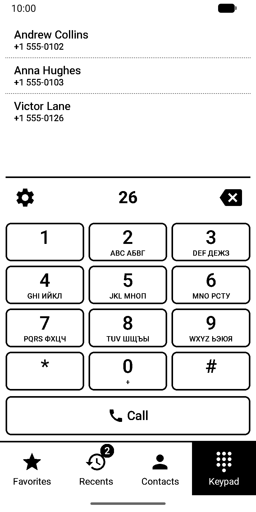
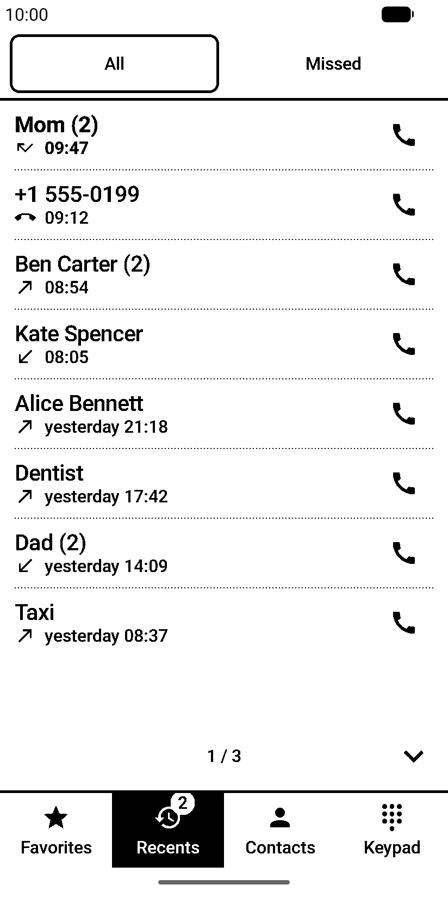
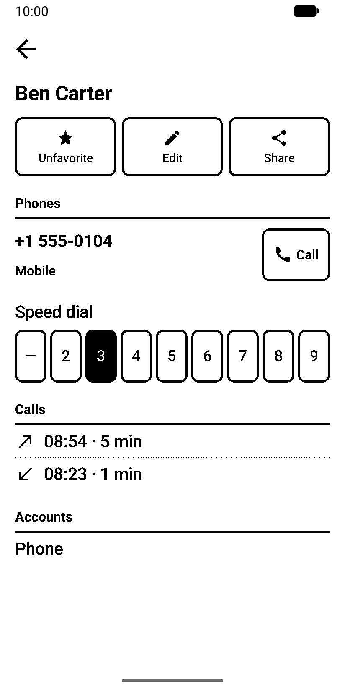
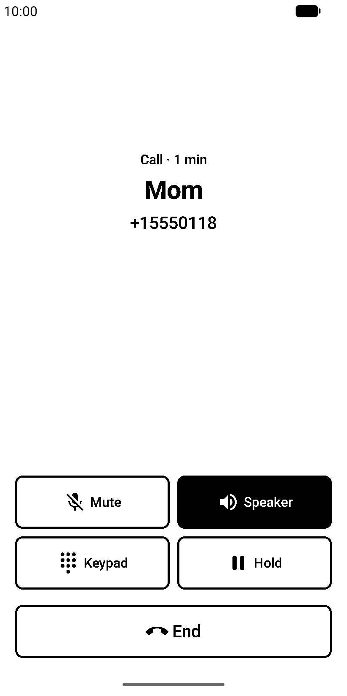
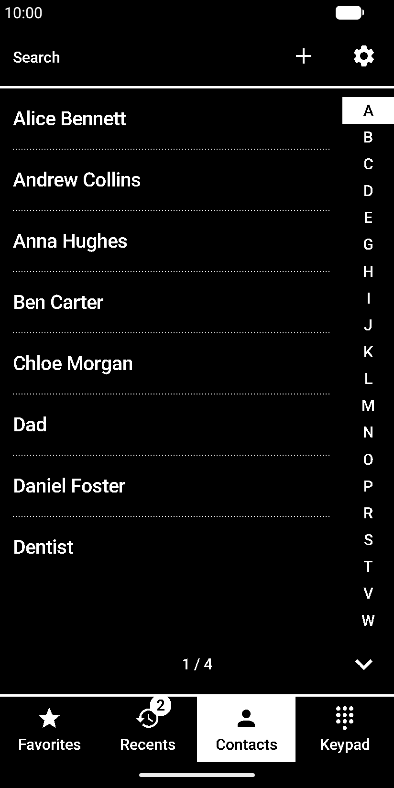
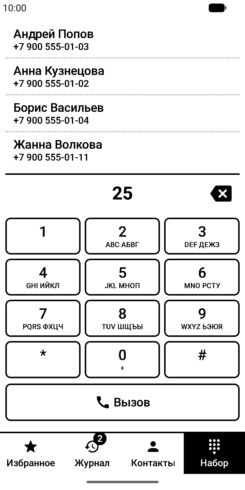
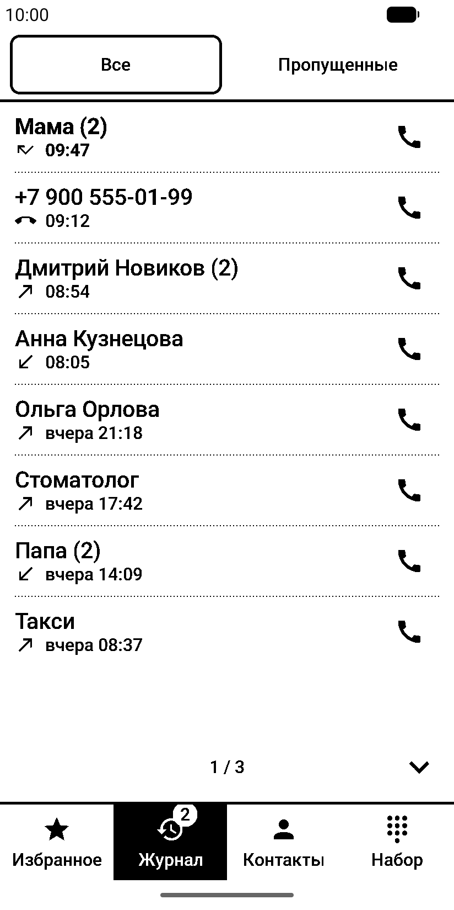
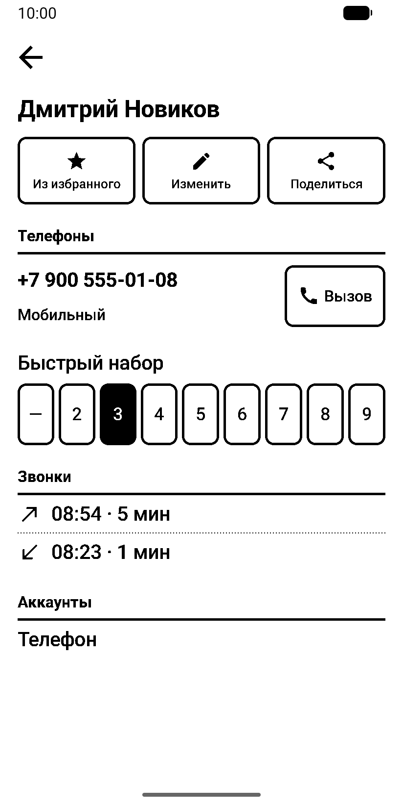
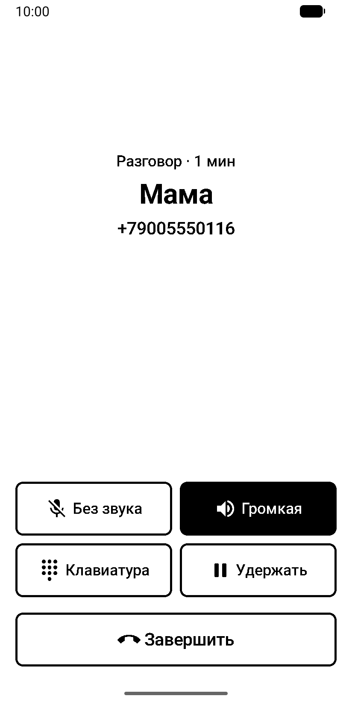
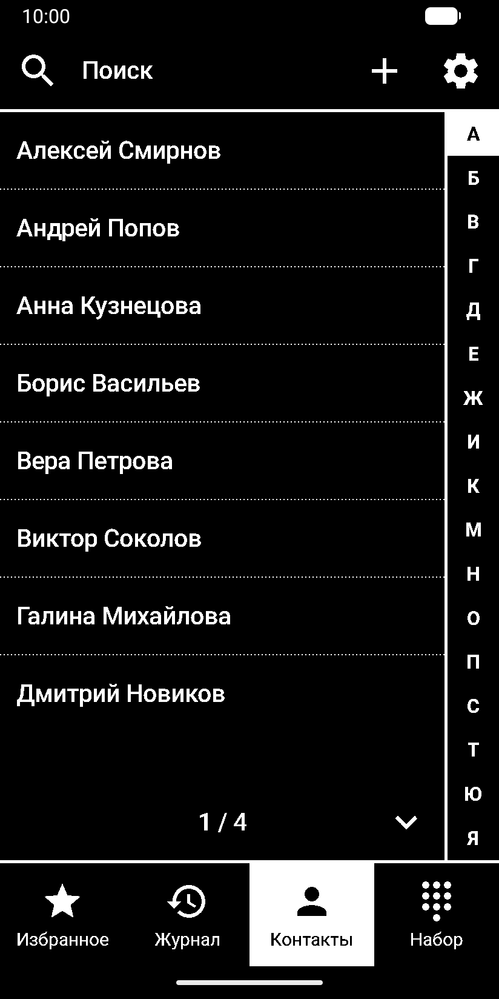

# Ink Phone

Phone app and contacts for Android phones with e-ink screens, built for the Hisense A9.

Every pixel is pure black or white: text is drawn without antialiasing with stems snapped to whole pixels, icons and emoji are two-tone, and there are no animations or ripples. Lists turn by pages instead of scrolling.

<p>
  
  
  
  
  
</p>

[Русская версия ниже](#ink-phone-1)

## Features

- Keypad with T9 search over Russian and English names and numbers, DTMF tones, long press 0 for +, 1 for voicemail and 2–9 for speed dial.
- Own call screen as the default phone app: answer and decline buttons, mute, speaker, Bluetooth, hold, keypad, call waiting, swap and merge, SIM choice. The call duration is shown in whole minutes so the panel is not redrawn every second.
- Recents grouped by number and day, with type icons, missed calls filter and a badge for new missed calls.
- Contacts with paged list, letter index, search by word prefixes in any order and by number; favorites; contact card with call history.
- Create, edit and delete contacts in Google or phone accounts; synchronisation is done by Android.
- vCard import and export: a single contact, a whole account, a selection or everything; duplicates are found by number and name.
- Optional full panel refresh on the Hisense A9 after calls and every N pages, through [A9PatchingService](https://github.com/AndreyGladkov/A9PatchingService) with “Allow Control via Broadcasts” on.
- Settings for text size, font weight, button corners, colors, tab labels, list mode, vibration strength for keys and buttons.

Ink Phone has no internet permission. See [PRIVACY.md](PRIVACY.md).

## Installation

Requires Android 11 or newer.

- **GitHub:** download `InkPhone-<version>-release.apk` from [Releases](https://github.com/AndreyGladkov/ink-phone/releases).
- **[Obtainium](https://github.com/ImranR98/Obtainium):** add `https://github.com/AndreyGladkov/ink-phone` as an app; Obtainium installs the APK from the latest release and updates it when a new one is published.

Both ship the same APK signed with the same key. Signing certificate SHA-256: `33:81:C5:38:72:91:A6:0A:CF:E1:BD:E2:E3:B1:1C:30:3D:52:81:3A:A1:AF:58:E1:B2:B5:36:4E:40:3A:2A:8B`.

After installing, make Ink Phone the default phone app in Settings → Calls, otherwise the system dialer keeps handling calls.

## Building

```
./gradlew testDebugUnitTest lintRelease assembleRelease
```

Release signing is read from `local.properties` (`signing.github.storeFile`, `signing.github.storePassword`, `signing.github.keyAlias`, `signing.github.keyPassword`); without these keys the release APK is built unsigned.

## License

Ink Phone is free software under the [GNU General Public License v3](LICENSE).

Bundled components: Noto Emoji font (SIL Open Font License 1.1), ez-vcard and Material icons (Apache License 2.0). Their license texts are in `app/src/main/assets/licenses` and in the app under Settings → About.

---

## Ink Phone

Звонилка и телефонная книга для Android-телефонов с e-ink экраном, сделанная под Hisense A9.

Каждый пиксель чисто чёрный или белый: текст рисуется без сглаживания со штрихами, подогнанными под пиксели, иконки и эмодзи двухцветные, анимаций и ряби при нажатии нет. Списки листаются страницами, а не прокруткой.

<p>
  
  
  
  
  
</p>

- Набор номера с поиском T9 по русским и английским именам и номерам, тоны DTMF, долгое нажатие: 0 — «+», 1 — голосовая почта, 2–9 — быстрый набор.
- Свой экран звонка как у звонилки по умолчанию: принять и отклонить, без звука, громкая связь, Bluetooth, удержание, клавиатура, второй входящий, переключение и объединение, выбор SIM. Длительность разговора показывается в минутах, чтобы панель не перерисовывалась каждую секунду.
- Журнал с группировкой по номеру и дню, иконками типа звонка, фильтром пропущенных и счётчиком новых пропущенных.
- Контакты постранично, с буквенным индексом, поиском по началу слов в любом порядке и по номеру; избранное; карточка с историей звонков.
- Создание, изменение и удаление контактов в аккаунте Google или на телефоне; синхронизирует сам Android.
- Импорт и экспорт vCard: один контакт, аккаунт, выбранные или все; дубли находятся по номеру и имени.
- Полная перерисовка экрана Hisense A9 после звонка и каждые N страниц через [A9PatchingService](https://github.com/AndreyGladkov/A9PatchingService) с включённым «Allow Control via Broadcasts».

У Ink Phone нет доступа в интернет, подробнее в [PRIVACY.md](PRIVACY.md).

## Установка

Нужен Android 11 или новее.

- **GitHub:** скачайте `InkPhone-<версия>-release.apk` со страницы [Releases](https://github.com/AndreyGladkov/ink-phone/releases).
- **[Obtainium](https://github.com/ImranR98/Obtainium):** добавьте приложение по адресу `https://github.com/AndreyGladkov/ink-phone`; Obtainium поставит APK из последнего релиза и будет обновлять его при выходе новых.

В обоих случаях это один и тот же APK, подписанный одним ключом. SHA-256 сертификата подписи: `33:81:C5:38:72:91:A6:0A:CF:E1:BD:E2:E3:B1:1C:30:3D:52:81:3A:A1:AF:58:E1:B2:B5:36:4E:40:3A:2A:8B`.

После установки сделайте Ink Phone звонилкой по умолчанию в «Настройки → Звонки», иначе звонки продолжит обрабатывать системное приложение.
