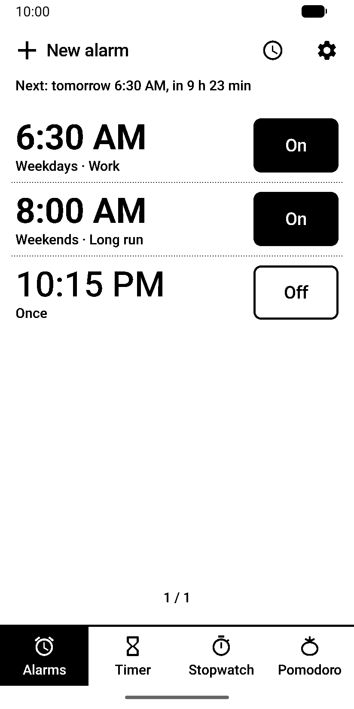
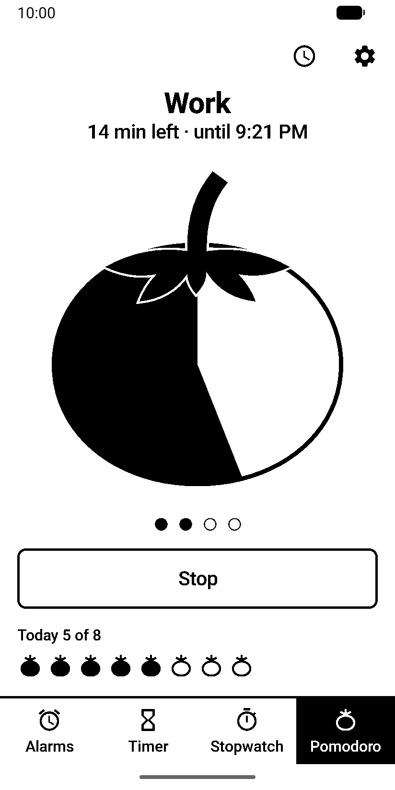
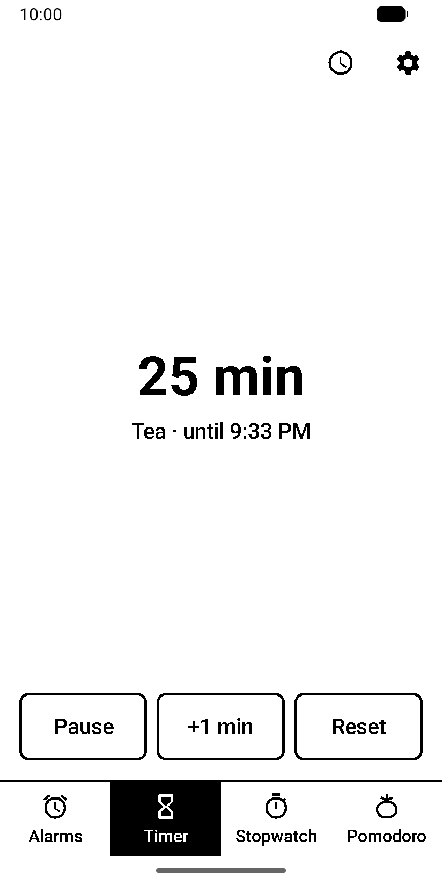
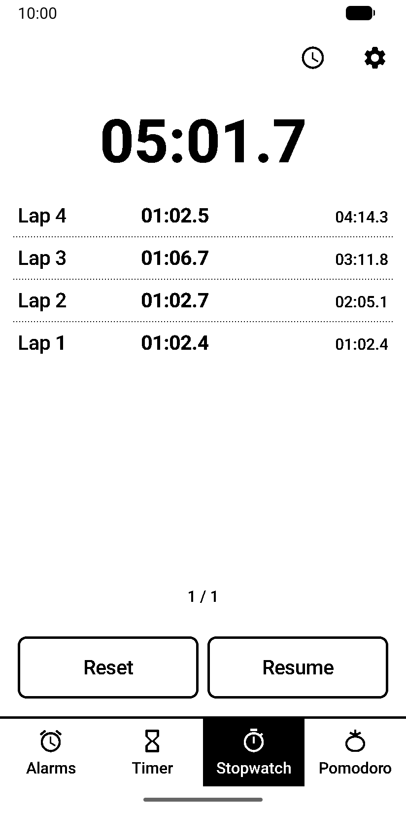
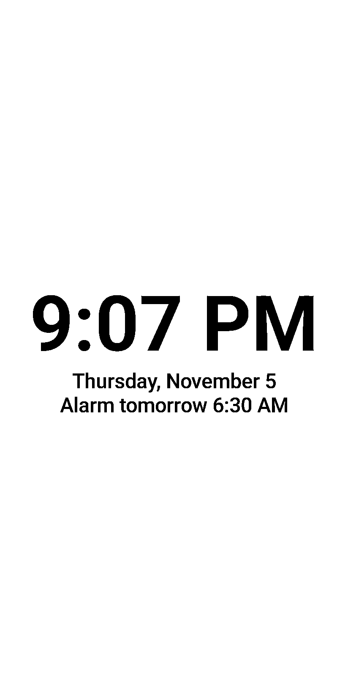
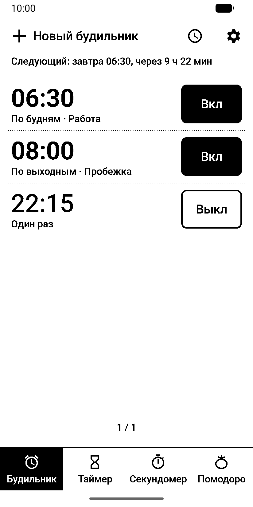
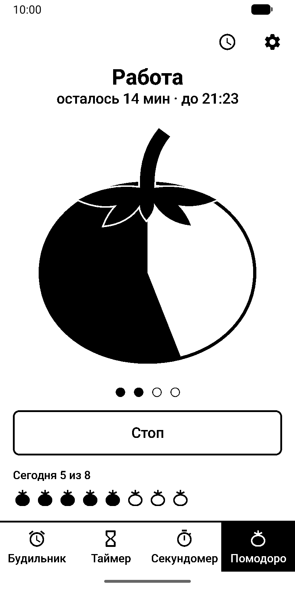
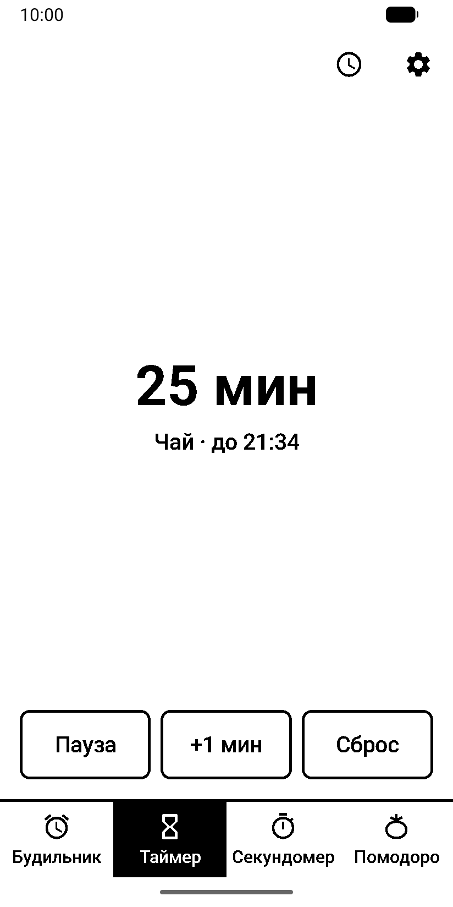
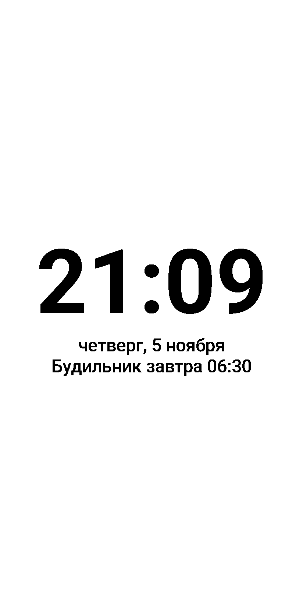

# Ink Clock

Alarms, timer, stopwatch, pomodoro and a desk clock for Android phones with e-ink screens, built for the Hisense A9 and made to look and behave like [Ink Phone](../ink-phone/README.md) and [Ink Messages](../ink-messages/README.md).

Every pixel is pure black or white, with no antialiasing and no animations. Nothing ticks faster than once a minute except the stopwatch while it is on screen and the last minute of a timer, so the panel stays quiet.

<p>
  
  
  
  
  
</p>

[Русская версия ниже](#ink-clock-1)

## Features

- Alarms with repeat days, a label, a ringtone and vibration. The time is typed on a keypad. A ringing alarm opens over the lock screen; Snooze is the big button and Dismiss has to be held for a second. Alarms ring after a reboot even before the phone is unlocked.
- Timer typed on a keypad, with the last four durations one tap away, pause, +1 min and a fixed "until 21:45" in the notification.
- Stopwatch with laps on pages; its seconds tick only while it is on screen.
- Pomodoro drawn as a big tomato: work eats it clockwise one minute at a time and a break fills it back. Work, break and long-break lengths, the cycle and a daily goal are set in Settings; the next phase starts on a tap. The screen can stay on during a phase.
- Desk clock and a screensaver for charging: the time, the date and the next alarm, or the pomodoro under way. On the Hisense A9 the panel is fully refreshed once an hour through [A9PatchingService](https://github.com/AndreyGladkov/A9PatchingService).
- Other apps can set alarms and timers through Android's standard alarm intents.
- Settings for text size, font weight, button corners, colors, tab labels, list mode and vibration, shared with the other Ink apps.

Ink Clock has no internet permission. See [PRIVACY.md](PRIVACY.md).

## Installation

Requires Android 11 or newer.

- **GitHub:** download `InkClock-<version>-release.apk` from [Releases](https://github.com/AndreyGladkov/ink/releases).
- **[Obtainium](https://github.com/ImranR98/Obtainium):** add `https://github.com/AndreyGladkov/ink` as an app and set "Filter release titles by regular expression" to `^Ink Clock `, because the repository also publishes other apps.

After installing, open the app and allow notifications: a ringing alarm shows its screen through them.

Android has no default clock app, so alarms other apps set make it ask which clock to use. To leave Ink Clock the only one, turn the built-in clock off over adb; its own alarms stop ringing too:

```
adb shell pm disable-user com.android.deskclock
```

For the screensaver, open Settings → Screensaver in the app, choose Ink Clock and start it while charging. It never starts while "Stay awake" in Developer options is on, because the screen then never goes off on the charger.

## Building

```
./gradlew :ink-clock:testDebugUnitTest :ink-clock:lintRelease :ink-clock:assembleRelease
```

Release signing is read from `local.properties` (`signing.clock.storeFile`, `signing.clock.storePassword`, `signing.clock.keyAlias`, `signing.clock.keyPassword`); without these keys the release APK is built unsigned.

Store screenshots are retaken with `uv run fastlane/screenshots/make_screenshots.py` on the `ink_a9` emulator with the debug build installed.

## License

Ink Clock is free software under the [GNU General Public License v3](LICENSE).

Bundled components: Noto Emoji font (SIL Open Font License 1.1) and Material icons (Apache License 2.0). Their license texts are in `ink-ui/src/main/assets/licenses` and in the app under Settings → About.

---

## Ink Clock

Будильник, таймер, секундомер, помодоро и настольные часы для Android-телефонов с e-ink экраном, сделано под Hisense A9 и выглядит и ведёт себя как [Ink Phone](../ink-phone/README.md#ink-phone-1) и [Ink Messages](../ink-messages/README.md#ink-messages-1).

Каждый пиксель чисто чёрный или белый, без сглаживания и анимаций. Чаще раза в минуту ничего не обновляется, кроме секундомера на экране и последней минуты таймера, поэтому панель не мельтешит.

<p>
  
  
  
  
  
</p>

- Будильники с днями повтора, подписью, мелодией и вибрацией. Время набирается на цифровой клавиатуре. Звонящий будильник открывается поверх экрана блокировки; «Отложить» — большая кнопка, а «Отключить» нужно удерживать секунду. После перезагрузки будильники звонят ещё до разблокировки телефона.
- Таймер с набором на клавиатуре, четырьмя последними значениями под рукой, паузой, «+1 мин» и неподвижным «до 21:45» в уведомлении.
- Секундомер с кругами постранично; секунды тикают только пока он на экране.
- Помодоро в виде большого помидора: работа съедает его по часовой стрелке по минуте, перерыв наливает обратно. Длительность работы и перерывов, цикл и цель на день задаются в настройках; следующая фаза начинается по нажатию. Экран можно не гасить во время фазы.
- Настольные часы и заставка на время зарядки: время, дата и ближайший будильник или идущий помодоро. На Hisense A9 панель раз в час полностью перерисовывается через [A9PatchingService](https://github.com/AndreyGladkov/A9PatchingService).
- Другие приложения могут ставить будильники и таймеры стандартными интентами Android.
- Настройки размера текста, толщины шрифта, скругления кнопок, цветов, подписей вкладок, режима списков и вибрации — общие с другими приложениями Ink.

У Ink Clock нет разрешения на доступ в интернет. Подробнее — в [PRIVACY.md](PRIVACY.md).

### Установка

Нужен Android 11 или новее.

- **GitHub:** скачайте `InkClock-<версия>-release.apk` в [Releases](https://github.com/AndreyGladkov/ink/releases).
- **[Obtainium](https://github.com/ImranR98/Obtainium):** добавьте `https://github.com/AndreyGladkov/ink` и в поле «Filter release titles by regular expression» укажите `^Ink Clock ` — в репозитории публикуются и другие приложения.

После установки откройте приложение и разрешите уведомления: через них звонящий будильник показывает свой экран.

«Часов по умолчанию» в Android нет, поэтому при будильнике из другого приложения система спрашивает, какие часы использовать. Чтобы остались только Ink Clock, выключите встроенные часы через adb — их собственные будильники тоже перестанут звонить:

```
adb shell pm disable-user com.android.deskclock
```

Для заставки откройте в приложении Настройки → Заставка, выберите Ink Clock и запуск во время зарядки. Пока в параметрах разработчика включено «Не выключать экран», заставка не запустится: на зарядке экран тогда не гаснет.
